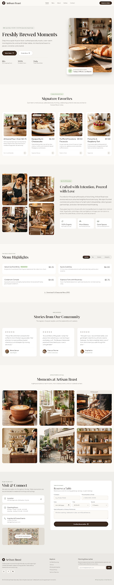

# Artisan Roast — Warm Artisanal Cafe & Micro Bakery

A modern, responsive landing page and web application for an artisanal specialty coffee shop and micro-bakery.



## 🌟 Features

- **Hero & Storytelling**: Warm visual presentation showcasing hand-roasted specialty coffee and fresh pastries.
- **Interactive Menu**: Categorized coffee blends, artisanal pastries, and seasonal specials.
- **Table Reservation & Ordering**: Online booking and pickup options.
- **Responsive Design**: Tailored with Tailwind CSS for mobile, tablet, and desktop screens.
- **Lightweight Server**: Built-in zero-dependency Node.js HTTP server.

## 🚀 Getting Started

### 1. View Directly in Browser
Simply open `index.html` in your favorite web browser (Chrome, Edge, Firefox, etc.).

### 2. Run with Node.js
If you have [Node.js](https://nodejs.org/) installed:
```bash
node server.js
```
Then visit [http://localhost:3000](http://localhost:3000) in your browser.

## 📁 Project Structure

- `index.html` — Main website markup and styles
- `code.html` — Source template code
- `DESIGN.md` — Design system specifications, typography, and palette
- `server.js` — Node.js static server
- `screen.png` — Visual preview screenshot
